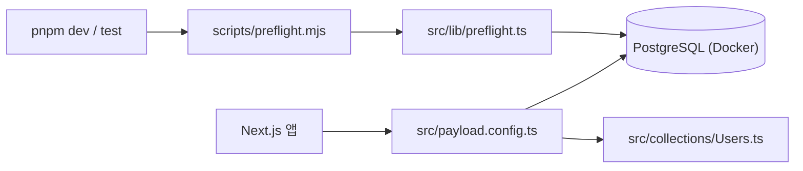

# 코드맵 개요

> SPEC-INFRA-001 완료 시점(2026-11-09)의 개요입니다. 기능 SPEC이 추가되면 `/moai codemaps`로 다시 생성합니다.

## 현재 모듈

| 모듈 | 파일 | 역할 |
|---|---|---|
| Payload 설정 | `src/payload.config.ts` | DB 어댑터, 컬렉션 등록, 시크릿·서버 URL |
| 관리자 인증 | `src/collections/Users.ts` | 관리자 계정 컬렉션 |
| 시작 전 점검 | `src/lib/preflight.ts`, `scripts/preflight.mjs` | 필수 환경 변수와 DB 연결 확인 |
| 사용자 화면 | `src/app/(frontend)/` | 임시 홈 페이지 |
| 관리자·API | `src/app/(payload)/` | Payload 템플릿 생성 라우트 |
| 테스트 | `tests/{unit,integration,e2e,helpers}` | Vitest 98건, Playwright 4건 |

## 프로젝트 목표

- 여행지 투어 프로그램을 한국어·영어로 소개하는 랜딩페이지 제공
- 투어별 회차와 정원을 관리하고, 신청 인원 합계가 정원에 도달하면 자동으로 마감
- 비회원·회원 모두 온라인으로 신청 가능 (개인정보 동의 필수)
- 이메일·비밀번호 회원 로그인과 내 신청 내역 조회 (회원 본인 것만)
- 신청자와 관리자에게 이메일 알림 발송
- 관리자가 신청 상태(대기·확정·취소)를 관리하고 CSV 내려받기와 통계(회차별 정원 대비 신청 인원)를 확인
- Vercel + Supabase 무료 요금제 범위 안에서 운영

실제·계획 구조는 `../structure.md`, 기술 스택은 `../tech.md`를 참고하세요.
