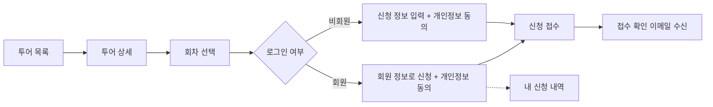
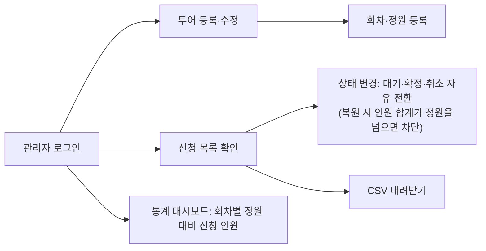

# 제품 개요 (product.md)

> 상태: 신규 프로젝트 — 아직 소스 코드가 없습니다. 이 문서는 `.moai/project/interview.md`에서 확정한 결정 사항(후속 질의 포함)을 근거로 작성했습니다. 인터뷰에 없는 설계 선택은 "제안"으로, 해석이 개입한 부분은 "가정"으로 표시합니다.

## 1. 프로젝트 정보

- 저장소 이름: `study2`
- 서비스 명칭: **숨비투어 / Soombi Tours** (슬러그 `soombi-tours`) — 상표·도메인 미확인, §8 참고
- 도메인: 웹 애플리케이션 (투어 소개 랜딩페이지 + CMS 기반 관리자)

## 2. 한 줄 설명

여행지에서 운영하는 여러 투어 프로그램을 한국어·영어로 소개하고, 회차별로 온라인 신청을 받으며, 관리자가 신청자를 확인하고 관리할 수 있는 웹사이트를 무료 인프라로 운영합니다.

## 3. 대상 사용자

| 사용자 | 설명 | 주요 목적 |
|---|---|---|
| 여행객(국내) | 한국어 화면으로 투어를 찾는 방문자 | 투어 비교, 회차 선택, 신청 |
| 여행객(외국인) | 영어 화면으로 투어를 찾는 방문자 | 위와 같음 |
| 회원 | 이메일·비밀번호로 가입한 여행객 | 빠른 신청, 내 신청 내역 확인 |
| 관리자 | 사이트 운영자 1명 (단일 관리자 역할) | 투어·회차 등록, 신청 상태 관리, CSV 내려받기, 통계 확인 |

## 4. 핵심 기능

1. **투어 목록·상세 페이지 (한·영)** — 투어 소개, 이미지, 일정 회차 표시
2. **회차·정원 관리** — 투어별 날짜·시간 회차 등록, 회차별 정원 설정, 정원이 차면 자동 마감. 정원은 신청 건수가 아니라 신청 인원 수 합계로 차감(예: 3명 신청 = 3자리), 신청 폼에 인원 수 입력란을 둠
3. **비회원 신청 / 회원 신청** — 두 방식 모두 허용, 개인정보 수집·이용 동의 체크박스 필수
4. **회원 인증** — 이메일 + 비밀번호 로그인(Payload 내장 인증), 내 신청 내역 조회
5. **이메일 알림** — 신청자에게 접수 확인 메일, 관리자에게 새 신청 알림 메일
6. **관리자 기능 (Payload 관리자 화면)**
   - 신청 상태 변경: 대기·확정·취소 사이에서 자유롭게 변경. 단, 취소 → 대기/확정으로 되돌릴 때 복원하는 신청의 인원을 더해 정원을 넘으면 변경을 막음
   - 신청자 CSV 내려받기 (관리자 전용)
   - 통계 대시보드: 회차별 정원 대비 신청 인원(인원 수 합계)만 표시

## 5. 사용자 흐름

### 5.1 여행객

- 정원이 찬 회차는 선택할 수 없도록 마감 상태로 표시합니다.
- 마감 전에는 취소된 신청을 정원 계산에서 제외합니다. 한번 마감된 회차는 이후 신청이 취소되어도 자동으로 다시 열리지 않으며, 관리자가 정원이나 마감 상태를 직접 수정해야 다시 열립니다. (후속 질의 답변 "한번 마감되면 그대로 유지"에 대한 해석이며, 기록된 가정입니다.)
- 비회원은 신청 내역을 조회할 수 없고 접수 확인 이메일로만 접수 사실을 확인합니다. 신청 내역 조회는 회원 전용이며, 회원은 본인 신청만 볼 수 있습니다.
- 언어 전환 방식은 URL 로케일(`/ko`, `/en`)을 제안합니다(`structure.md` 참고, 첫 SPEC에서 확정).

### 5.2 관리자

- 새 신청이 들어오면 관리자에게 알림 메일이 발송됩니다.
- 신청자 개인정보(이름·이메일·연락처 등) 열람과 CSV 내려받기는 관리자만 할 수 있습니다.

## 6. 범위 밖 (Out of Scope)

- 온라인 결제 및 환불 (결제는 현장 또는 계좌이체로 별도 처리)
- 소셜 로그인
- 카카오 알림톡
- 다중 관리자 권한 분리
- 한국어·영어 외 추가 언어 (중국어, 일본어 등)

## 7. 로드맵 / 후속 기능 후보

아래 항목은 각각 이후 `/moai plan`으로 별도 SPEC을 작성할 후보입니다. 순서는 의존 관계를 반영한 제안입니다.

| 순서 | 후보 | 내용 | 선행 조건 |
|---|---|---|---|
| 1 | 프로젝트 기반 구축 | Next.js + Payload 단일 앱 골격, 로컬 PostgreSQL 연결, 테스트 환경(Vitest·Playwright) | 없음 |
| 2 | 투어 카탈로그 + 회차 (완료 — SPEC-TOUR-001) | Tours·TourSessions 컬렉션, 목록·상세 페이지 | 1 |
| 3 | 신청 흐름 + 정원 | Applications 컬렉션, 비회원 신청, 개인정보 동의, 정원 도달 시 자동 마감. 인원 합계 기준 정원 차감. **도출 요구사항(가정): 동시 신청에도 정원을 넘지 않도록 트랜잭션 또는 잠금으로 처리**(구체 방식은 해당 SPEC에서 결정, §8.2 참고) | 2 |
| 4 | 회원 인증 | Members 인증 컬렉션, 가입·로그인, 회원 신청, 내 신청 내역 | 3 |
| 5 | 이메일 알림 | 접수 확인·관리자 알림 메일, 발송 서비스 연동 | 3 |
| 6 | 관리자 운영 기능 | 상태 변경(인원 합계가 정원을 넘으면 취소 복원 차단), CSV 내려받기(관리자 전용), 통계 대시보드(회차별 정원 대비 신청 인원) | 3 |
| 7 | 다국어(i18n) | Payload localization(ko/en), 로케일 라우팅, UI 문구 번역 | 2 (점진 적용 가능) |
| 8 | 배포 | Vercel + Supabase(풀러·Storage) 연결, 환경 변수, 운영 점검 | 1~6 |

## 8. 결정 필요 항목

사용자 결정이 필요한 항목은 이 절에서만 관리하며, 다른 문서는 이 절을 참조합니다. S3 어댑터 패키지명, 마이그레이션 절차, 린트 도구 같은 구현 수준의 미확정 사항은 `tech.md`에서 다룹니다.

- ~~**개인정보 보관 기간·파기 방식**~~ — 2026-11-08 결정(사용자 위임, 법률 검토 참고안). 아래 §8.3 참고. **출시 전 전문가 확인 필요**
- ~~**서비스 정식 명칭**~~ — 숨비투어 / Soombi Tours로 결정(사용자 위임). 상표·도메인 미확인 — 출시 전 확인 필요 (`design/claude-design-prompt.md` 참고)
- **이메일 발송 서비스** — 무료 요금제 후보인 Resend와 일반 SMTP 제공자(Payload Nodemailer 어댑터 사용) 중 선택 결정 필요 (`tech.md` 2절 참고)
- ~~**패키지 매니저**~~ — pnpm으로 결정 (첫 기능 설계 시 확정)

### 8.1 후속 질의에서 정해진 항목 (참고)

- 정원 차감 단위: 신청 인원 수만큼 차감(3명 신청 = 3자리). 자동 마감·취소 복원 차단·대시보드 모두 인원 합계 기준
- 취소와 정원: 마감 전에는 취소 신청을 정원에서 제외하고, 마감 후에는 자동으로 다시 열지 않음(관리자 수동 수정) — 기록된 가정
- 비회원 신청 조회: 제공하지 않음(접수 확인 이메일만)
- 신청 상태 변경: 대기·확정·취소 자유 전환, 복원하는 인원을 더해 정원을 넘으면 취소 → 대기/확정 복원 차단
- 통계 대시보드 지표: 회차별 정원 대비 신청 인원(인원 수 합계)

### 8.2 결정에서 도출한 요구사항 (가정)

- 동시 신청 처리: "정원 도달 시 자동 마감" 결정(interview.md Stage A Round 3)을 지키려면 동시 신청에도 정원을 넘지 않아야 하므로, 트랜잭션 또는 잠금으로 처리하는 것을 요구사항으로 둡니다. 사용자가 직접 정한 항목이 아닌 도출된 가정이며, 구현 방식은 신청 흐름 SPEC에서 결정합니다.

### 8.3 개인정보 보유기간과 동의 (2026-11-08 결정, 출시 전 전문가 확인 필요)

법률 담당 에이전트의 검토를 참고해 정했습니다. 인용 조문은 민간 법령 사이트(casenote.kr)에서만 확인했고, 국가법령정보센터 원문 대조와 2026. 9. 11. 시행 개인정보 보호법 개정 반영 여부는 아직 확인하지 않았습니다. 법률 자문이 아니므로 출시 전에 변호사나 개인정보 전문가의 확인을 받습니다.

| 정보 | 보유기간 | 처리 방법 | 근거(미확정 인용) |
|---|---|---|---|
| 신청 기록(이름·이메일·연락처·인원·회차·상태·취소 내역) | 투어 종료일(취소 시 취소일)부터 5년 | 목적 달성 후 운영 데이터와 분리 보관, 접근 권한 최소화, 기간 만료 시 복구 불가능하게 삭제 | 전자상거래법 시행령 제6조(계약·청약철회 기록 5년), 개인정보 보호법 제21조 |
| 입금 확인 기록 | 5년 | 위와 같음 | 전자상거래법 시행령 제6조(대금결제 기록 5년) |
| 불만·분쟁 처리 기록 | 3년 | 위와 같음 | 전자상거래법 시행령 제6조 |
| 요청 사항(자유 입력) | 투어 종료 후 지체 없이 파기 | 분쟁이 생기면 분쟁 기록으로만 보관 | 최소 수집 원칙(판단) |
| 회원 계정 | 회원 탈퇴 시까지 | 탈퇴 시 지체 없이 파기하되 위 신청 기록은 기간만큼 분리 보관 | 개인정보 보호법 제21조 |

동의 화면 요구사항:

- 필수 동의에 ① 수집 항목 ② 목적 ③ 보유기간 ④ 거부할 권리와 거부 시 신청 불가를 국문·영문으로 고지합니다(제15조 제2항).
- 요청 사항·회원가입·마케팅 수신은 선택 동의로 분리하고, 거부해도 신청할 수 있다고 명시합니다(제22조).
- 요청 사항 입력란에 "건강·장애 등 민감한 정보는 적지 마세요" 안내를 둡니다(민감정보 수집 회피, 판단).
- 이메일 발송 등 해외 서비스를 쓰면 국외 이전 사항을 개인정보 처리방침에 공개합니다(제28조의8).
- 전자상거래법 적용 여부는 사업자 유형(여행업 등록, 통신판매업 신고)에 따라 달라질 수 있어 확정하지 않았습니다. 보수적으로 적용된다고 보고 5년을 택했습니다.

## 9. 주의할 점

- **Vercel Hobby 요금제는 비상업적 개인 용도로 한정됩니다.** 실제 상업 운영(유료 투어 판매 등)에 쓰려면 Pro 요금제 전환을 검토해야 합니다. 정확한 조건은 현재 Vercel 공식 약관 확인 필요.
- **Supabase Free 요금제는 일정 기간 활동이 없으면 프로젝트가 일시 정지됩니다.** 정지 시 사이트가 데이터베이스에 접속하지 못하므로, 운영 중에는 주기적 사용 여부를 점검해야 합니다. 정지 기준 기간은 현재 공식 문서 확인 필요.
- 무료 요금제 한도(메일 발송량, 저장 용량, 대역폭 등)는 수시로 바뀌므로 배포 단계에서 현재 공식 문서를 다시 확인합니다.
