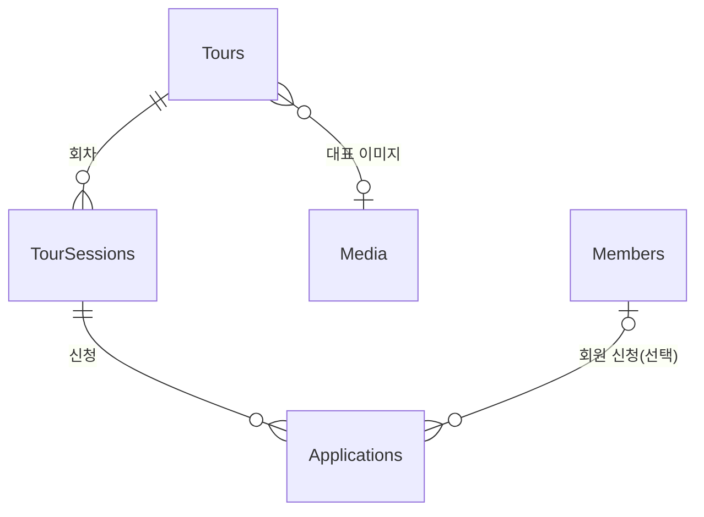

# 구조 설계 (structure.md)

> 상태: **기반 구축 완료(SPEC-INFRA-001, 2026-11-09)** — 앱 골격·테스트·도구 구성은 §2.1의 실제 구조를 따릅니다. §2의 기능 경로(로케일 라우팅, 투어·신청 화면 등)는 이후 SPEC에서 만들 예정인 제안 구조입니다.

## 1. 전체 방향

Payload CMS(3.93.0, `tech.md` 참고)는 Next.js 앱 안에서 함께 실행됩니다. 따라서 프론트엔드와 관리자 화면, API를 하나의 Next.js App Router 프로젝트로 구성합니다. 라우트 그룹으로 사용자 화면 `(frontend)`과 Payload 관리자 `(payload)`를 분리합니다.

## 2. 디렉터리 구성 (제안)

```text
study2/
├── src/
│   ├── app/
│   │   ├── (frontend)/
│   │   │   └── [locale]/              # ko / en 로케일 라우팅
│   │   │       ├── page.tsx           # 랜딩(투어 목록)
│   │   │       ├── tours/[slug]/      # 투어 상세 + 회차 선택
│   │   │       ├── apply/             # 신청 폼 / 접수 완료
│   │   │       ├── login/ signup/     # 회원 인증
│   │   │       └── my/applications/   # 내 신청 내역
│   │   └── (payload)/
│   │       ├── admin/                 # Payload 관리자 화면
│   │       └── api/                   # Payload REST/GraphQL 라우트
│   ├── collections/                   # Payload 컬렉션 정의
│   ├── components/                    # 공용 UI 컴포넌트
│   │   └── admin/                     # 관리자 커스텀 화면(대시보드 등)
│   ├── lib/                           # 서버 로직(정원 확인, 메일 발송, CSV 생성)
│   ├── i18n/                          # UI 문구 사전(ko, en), 로케일 설정
│   └── payload.config.ts              # Payload 설정(DB, 스토리지, 로컬라이제이션, 컬렉션 등록)
├── tests/
│   ├── unit/                          # Vitest 단위 테스트
│   ├── integration/                   # Vitest 통합 테스트(Payload + DB)
│   └── e2e/                           # Playwright E2E(신청 흐름)
├── public/                            # 정적 파일
├── docker-compose.yml                 # 로컬 PostgreSQL (선택)
└── .env.example                       # 환경 변수 이름 목록(값 없음)
```

| 경로 | 역할 |
|---|---|
| `src/app/(frontend)/[locale]` | 여행객이 보는 화면. 모든 경로가 로케일 접두어를 가짐 |
| `src/app/(payload)` | Payload가 제공하는 관리자 화면과 API. 직접 수정은 최소화 |
| `src/collections` | 데이터 모델. 컬렉션 하나당 파일 하나 |
| `src/components/admin` | 통계 대시보드, CSV 내려받기 버튼 등 관리자 화면 확장 |
| `src/lib` | 정원 확인·자동 마감, 이메일 발송, CSV 변환 등 업무 로직 |
| `src/i18n` | 컬렉션 데이터가 아닌 고정 UI 문구 번역 |
| `tests/` | 테스트 종류별 분리 |

### 2.1 현재 실제 구조 (SPEC-INFRA-001 완료 시점)

```text
study2/
├── src/
│   ├── app/
│   │   ├── (frontend)/            # layout.tsx, page.tsx(임시 홈), globals.css
│   │   └── (payload)/             # Payload 템플릿 생성 파일(admin/, api/, layout.tsx, custom.scss)
│   ├── collections/
│   │   └── Users.ts               # 관리자 인증 컬렉션
│   ├── lib/
│   │   └── preflight.ts           # 환경 변수·DB 연결 시작 전 점검(단일 모듈)
│   ├── payload.config.ts
│   └── payload-types.ts           # Payload 생성 타입
├── scripts/
│   └── preflight.mjs              # dev·test 시작 전 점검 실행 진입점
├── tests/
│   ├── unit/                      # 점검 로직, CLI, 저장소 규칙(repo-rules.spec.ts)
│   ├── integration/               # 설정·환경 변수, Users 인증(실제 DB)
│   ├── e2e/                       # 홈·관리자 화면, global-setup.ts
│   └── helpers/                   # E2E 환경·단언, 테스트 관리자 도우미
├── docker-compose.yml             # 로컬 PostgreSQL(프로젝트 이름 sumbi-tour, 127.0.0.1 바인딩)
├── .env.example                   # 환경 변수 이름 목록
├── package.json / pnpm-lock.yaml / pnpm-workspace.yaml
├── next.config.ts / tsconfig.json / postcss.config.mjs
├── eslint.config.mjs / prettier.config.mjs / .prettierignore / .gitattributes
├── vitest.config.mts / playwright.config.ts
├── CHANGELOG.md
└── README.md                      # 한국어 개발 환경 안내
```

메모:

- `src/app/(payload)` 아래 "DO NOT MODIFY" 표시가 있는 템플릿 파일 3개는 Prettier 규칙에 맞춰 포맷만 바뀌었습니다. Payload 업그레이드로 재생성하면 포맷 차이가 다시 생길 수 있습니다.
- 계획 단계에서 선택 사항이던 `docker-compose.yml`은 필수 구성으로 확정되었습니다.

## 3. Payload 컬렉션 설계 (개념 수준)

| 컬렉션 | 용도 | 주요 필드 | 관계 |
|---|---|---|---|
| `Tours` | 투어 프로그램 | 제목·설명(다국어), slug, 대표 이미지, 소요 시간, 집결 장소(다국어), 가격 안내 문구(다국어), 공개 여부 | 1:N `TourSessions`, N:1 `Media` |
| `TourSessions` | 투어 회차 | 소속 투어, 시작 일시, 종료 일시, 정원, 점유 인원(대기·확정 신청의 인원 수 합계, 저장값 또는 계산값), 상태(모집 중 / 마감) | N:1 `Tours`, 1:N `Applications` |
| `Applications` | 신청 내역 | 회차, 신청자 이름, 이메일, 연락처, 인원 수(정원 차감 단위, 1 이상), 요청 사항, 개인정보 동의 여부·동의 일시, 상태(대기 / 확정 / 취소), 신청 언어, 회원(선택) | N:1 `TourSessions`, N:1 `Members`(선택) |
| `Members` | 여행객 회원 (인증 컬렉션) | 이메일, 비밀번호(Payload 인증), 이름, 연락처, 선호 언어 | 1:N `Applications` |
| `Users` | 관리자 (인증 컬렉션) | 이메일, 비밀번호 | 관리자 화면 접근 전용 |
| `Media` | 업로드 이미지 | 파일, 대체 텍스트(다국어) | `Tours`에서 참조 |

설계 메모:

- `Members`와 `Users`는 서로 다른 인증 컬렉션으로 분리합니다. 회원은 관리자 화면에 접근할 수 없어야 합니다.
- 정원은 신청 인원 수 합계로 차감합니다(3명 신청 = 3자리). 자동 마감·취소 복원 차단·대시보드 모두 이 합계를 기준으로 합니다.
- 정원 자동 마감은 신청 생성 시점에 서버에서 확인합니다. 동시 신청으로 정원을 넘기지 않도록 트랜잭션 또는 잠금으로 처리해야 합니다. 이는 자동 마감 결정에서 도출한 요구사항(가정, `product.md` §8.2)이며, 구체 방식은 신청 흐름 SPEC에서 결정합니다.
- 마감 전에는 취소된 신청을 정원 계산에서 제외합니다. 회차가 한번 마감되면 이후 취소가 생겨도 자동으로 다시 열지 않고, 관리자가 정원 또는 마감 상태를 직접 수정해야 다시 열립니다(기록된 가정 — `product.md` 5.1절).
- 신청 상태는 관리자가 대기·확정·취소 사이에서 자유롭게 바꿀 수 있으나, 취소 → 대기/확정 복원은 해당 신청의 인원을 더했을 때 정원을 넘으면 차단합니다.
- 접근 권한: `Applications` 읽기는 관리자 전체, 회원은 본인 신청만, 비회원은 조회 불가(접수 확인 이메일만 제공). CSV 내려받기와 신청자 개인정보 열람은 관리자 전용입니다.
- 개인정보 보관·파기: 신청 기록은 투어 종료(취소 시 취소일)부터 5년 분리 보관 후 파기, 요청 사항은 투어 종료 후 파기, 회원 계정은 탈퇴 시 파기합니다(`product.md` §8.3). 이를 위해 `Applications`에 선택 동의 여부(요청 사항·마케팅)와 보관 만료 판단에 쓸 기준일이 필요하며, 구체 필드와 파기 방식은 신청 흐름 SPEC에서 정합니다.

## 4. 관계도


